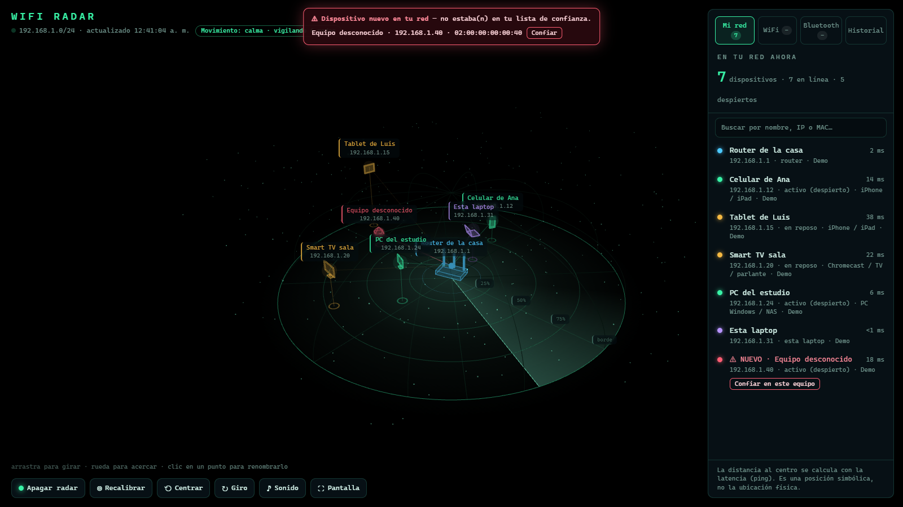
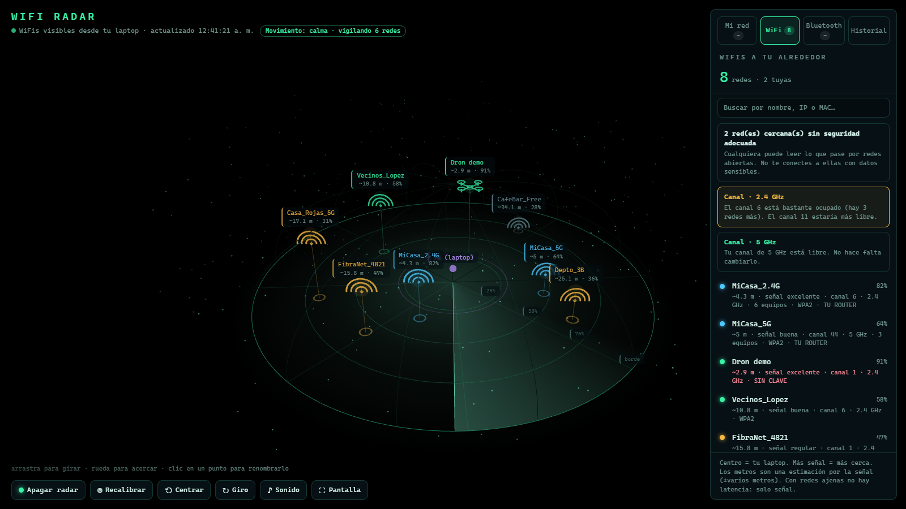
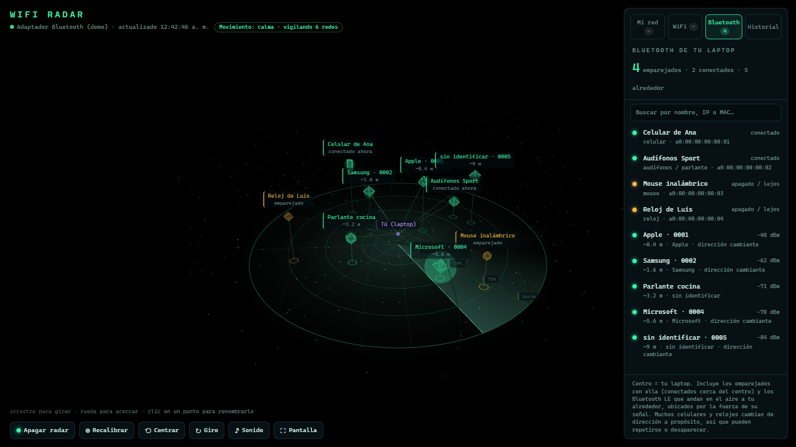
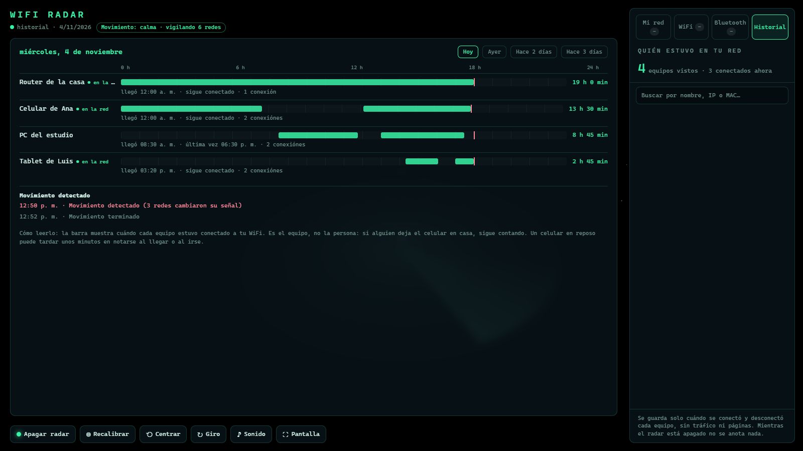

# WiFi Radar

Radar 3D de tu red local y de los WiFis de alrededor. Solo Python y un navegador; todo corre en tu propia laptop.
**Solo para redes tuyas o con permiso del dueño.**

> Las capturas usan el **modo demo** (datos inventados), no una red real.

| WiFis cercanos | Bluetooth |
|---|---|
|  |  |

## Usar
Doble clic en `iniciar.bat` (abre http://radar.localhost:8765). O desde una terminal: `python server.py`.
Necesita Python 3 y Windows. Hace falta internet para cargar la librería Three.js desde jsDelivr.

**Probar sin escanear nada (modo demo):** `python server.py --demo` y abre http://radar.localhost:8766.

## Qué hace
- **Mi red:** dispositivos conectados con ícono 3D por tipo, estado (activo / en reposo) y latencia.
- **Alerta de dispositivo nuevo:** lo que no está en `known.json` aparece en rojo, con aviso y sonido.
  La primera vez que corre, lo que ya está conectado se toma como "conocido". Botón "Confiar" para añadir más.
- **WiFis cercanos:** señal, distancia estimada, canal, banda, seguridad y equipos conectados.
- **Bluetooth:** equipos emparejados con tu laptop (mouse, audífonos, celular…) y si están conectados ahora,
  más los Bluetooth LE que andan en el aire a tu alrededor, con señal y distancia estimada. Es escucha pasiva:
  no se conecta a nada. Muchos celulares cambian de dirección a propósito, así que no siempre se pueden seguir.
  El escáner (`ble/BleScan.cs`) se compila solo la primera vez con el compilador de .NET que trae Windows.
- **Avisos de seguridad:** redes sin clave o con WEP, posible "gemelo malvado" (otra red con el nombre de la tuya).
- **Recomendador de canal:** compara la saturación con tus vecinos y sugiere un canal para tu router.

## Historial y movimiento
- **Historial:** pestaña con una barra de 24 h por equipo (cuándo llegó, cuándo se fue, cuánto tiempo estuvo).
  Se guarda en `history.db` (solo MAC, nombre y horas; nada de tráfico ni páginas). Contiene datos de personas: no lo compartas.
- **Movimiento:** `motion.py` calibra ~1 minuto la señal normal de las redes cercanas y avisa si varias cambian a la vez
  (idea de KevinB2212/wifi-radar). Es aproximado: no distingue una persona de una puerta o un microondas. Botón **Recalibrar**.
- Mientras el radar está apagado no se anota nada, y ese hueco no cuenta como presencia.

## Botones
- **Apagar / Encender radar:** pausa o reanuda todos los escaneos (red, WiFi y Bluetooth). Apagado, la escena se oscurece.
- **Centrar**, **Giro**, **Sonido**, **Pantalla:** vista inicial, giro automático, alerta sonora y pantalla completa.
- **Buscador** en el panel, y clic en cualquier punto (incluso una red WiFi) para ponerle nombre.

## Archivos
- `server.py`: escáner (ping + ARP + netsh) y servidor local. Solo escucha en 127.0.0.1.
- `web/index.html`: el radar 3D.
- `history.py`: historial de presencia. `motion.py`: detector de movimiento. `ble/BleScan.cs`: escáner Bluetooth.
- `demo.py`: datos inventados para el modo demo y las capturas.
- `names.json`: nombres que tú asignas. `known.json`: equipos de confianza. Ambos se crean al usarlo y **no se suben a git**.

## Seguridad
- El servidor solo escucha en `127.0.0.1` (tu propia laptop), sin contraseña ni cuentas.
- Solo atiende a la **página del propio radar**: rechaza pedidos de otras páginas abiertas en tu navegador
  (revisa `Host`, `Origin`, `Sec-Fetch-Site` y exige `application/json` en los botones). Ver `Handler._blocked` en `server.py`.
- Si algún día lo expones a otros equipos de tu red, hace falta agregar una contraseña.

## Límites
Muestra dispositivos, no personas. Las distancias son estimaciones. "Activo / en reposo" sale del ping,
no mide datos. El movimiento por señal WiFi es aproximado; para algo mejor hace falta un ESP32 con CSI.
